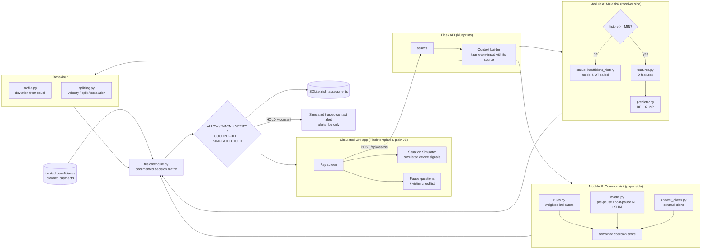

# SafePay Shield: Architecture (Phase 2)

> Simulation only. No real UPI, NPCI or bank connection. Holds are always "simulated".
> Model results on synthetic data show feasibility, not real-world accuracy.

## 1. System overview



### Request flow for one payment

1. **First pass (before any questions).** The user taps Pay. `/api/assess` runs with
   database-derived context and simulated device signals. Pause answers are not available
   yet, so the **pre-pause coercion model** is used.
2. **Decision.**
   - ALLOW → green success screen.
   - WARN + VERIFY → pause questions and checklist shown.
   - HOLD → red cooling-off screen (questions still shown as optional context).
3. **Second pass (after the answers).** `/api/assess` runs again with `stage="post_pause"`.
   The **post-pause coercion model** is used, `answer_check.py` looks for contradictions,
   and the fusion engine re-decides. A second pass can raise the decision but never
   lowers a HOLD that came from a severe indicator.
4. `/api/payments/confirm` records the simulated outcome (proceeded or cancelled).

## 2. Key design decisions

### 2.1 Mule model: minimum-history rule (decided after Phase 1)

| Setting (`config.py`) | Value | Meaning |
|---|---|---|
| `MULE_MIN_HISTORY_TXNS` | `5` | A payee needs at least this many recorded transactions before the mule model is called. |
| `MULE_THRESHOLD` | `0.10` | From the pkl. `flag = probability >= 0.10`. |
| `MULE_HIGH_BAND` | `0.40` | A documented demo choice. `elevated` is 0.10–0.40 and `high` is ≥ 0.40. |

**Why 5.** I probed the provided model with 200 simulated plausible clean payee
histories at each size (scratchpad probe, to be added as
`scripts/probe_mule_history.py` in Phase 4 with its output saved to `reports/`):

| Transactions | Clean histories flagged (≥ 0.10) |
|---|---|
| 0 (all zeros) | score 0.747 |
| 1 | 100% |
| 2 | 60% |
| 3 | 27% |
| 5 | 3% |
| 8–15 | 1–4% |

Below 5 transactions, the score reflects how little data there is, not how the
money moves. The model's own split points also show it was trained on much larger
accounts (its typical `total_transactions` split is around 1,164). Five is the
smallest count at which clean histories stop being flagged as a matter of course.

**Behaviour.**
- History below the minimum gives `status: "insufficient_history"`, the model is
  **not called** and the result has no probability or band.
- `status: "unavailable"` is kept for a model that failed to load or failed the
  feature-order check.
- With either status, the fusion engine decides **on coercion signals alone** and
  says so in the explanation, for example: *"This account is too new for us to check
  how money moves through it. This decision is based on the payment situation only."*
- For the "mule-only" evaluation baseline, `insufficient_history` counts as **not
  flagged**. This is exactly the gap SafePay Shield is designed to close.

### 2.2 Two-stage coercion model (new finding)

The dataset's `ans_know_payee`, `ans_someone_guiding` and `ans_purpose` columns are
pause-screen answers. **They don't exist on the first pass.** Filling them with defaults
would break the rule against sending invented values to a model. So two models are
trained with the same recipe (RF, plus XGBoost if it installs; stratified 70/30 split,
`seed=42`):

| Model | Used when | Features |
|---|---|---|
| `coercion_model_prepause` | First pass | Payer-side only, without `ans_*` |
| `coercion_model_postpause` | After the pause answers | Payer-side plus one-hot `ans_*` |

Both use **payer-side features only**. They leave out `payee_vpa_age_days` and
`payee_prior_complaints`, because the mule model covers the payee side.
`payee_is_new`, `payee_in_contacts` and `payee_type` stay in, because they describe the
*payer's relationship* to the payee, which the payer's app knows. An optional variant
that includes the payee columns is trained for comparison only and is never used in
the live app.

Pre-pause features (26 after one-hot):
`hour_of_day, user_age, account_tenure_months, avg_txn_amount_90d, balance_before_txn,
amount_inr, amount_to_avg_ratio, amount_pct_of_balance, payee_is_new, payee_in_contacts,
payee_type (P2P/P2M), on_voice_call, on_video_call, call_duration_min, caller_in_contacts,
caller_is_international, screen_share_active, remote_access_app_installed_7d,
session_duration_sec, hesitation_events, segmented_typing, app_switches, vpa_pasted,
new_payee_txns_24h, amount_sent_new_payees_24h, fd_or_loan_liquidated_7d`

The model is never trained on: `txn_id, scam_type, sample_group, hard_negative_reason,
label_noisy`.

**Known data artefact (reported in the model card).** The purposes `govt_fine_verification`,
`refund_cashback` and `job_task_fee` appear **only** on coerced rows. The post-pause model
will lean on them, and its metrics will look better than a real-world model would. The
model card reports pre-pause and post-pause metrics side by side so this stays visible.

### 2.3 Where every input comes from

Every value sent to a model or rule is tagged with its source. The "Why?" panel shows
these tags.

| Source tag | Inputs | Origin |
|---|---|---|
| `db_derived` | Payer profile, `amount_to_avg_ratio`, `payee_is_new`, `payee_in_contacts`, 24h velocity, the 9 mule features | SQLite (fictional seed data) |
| `simulated_device_signal` | Call state, call duration, caller info, screen share, remote app, hesitation, typing, app switches, pasted VPA | Situation Simulator |
| `user_answer` | `ans_*`, victim checklist | Pause screen |
| `user_entered` | Payee VPA, amount | Pay screen |

If a required input is missing, the affected component returns `unavailable` with the
missing field names. Nothing is filled in silently.

### 2.4 Coercion score

- `rule_score_normalised` = sum of fired rule weights divided by `RULE_SCORE_CAP`.
  Rules on an unknown payee or a high amount only add weight **when a pressure signal
  also fires**.
- `coercion_score = max(rule_score_normalised, ml_probability)`. The ML part uses
  whichever model matches the current stage.
- Any `severe` indicator forces the band to at least `high`.
- An answer-vs-signal contradiction adds `CONTRADICTION_WEIGHT` to the rule score.
- Band cut-offs (`COERCION_MEDIUM`, `COERCION_HIGH`) are chosen on a **validation split
  taken from the 70% training portion**, never on the 30% test set. The choice and its
  reasoning are written into `coercion_model_card.json`.

### 2.4b Phase 5 additions (decided during implementation)

- **Rules' pressure gate.** Context indicators (new payee, large amount, pasted UPI ID,
  app switching, share of balance) only count when a pressure indicator fired.
- **ML pressure gate.** With no pressure indicator, if at least 75% of the coercion
  model's risk-raising SHAP evidence comes from payee/amount features (including the "do
  you know this person" answer), the model's concern is not counted
  (`PAYEE_AMOUNT_ONLY_SHARE`). Together, the two gates guarantee that **an unknown payee or
  a high amount can never establish coercion on its own**.
- **Rule revision v2.** This was made on validation evidence after the first test run, and
  is recorded in the model card:
  - "Someone is guiding me" is severe only during a call with an unknown number.
  - The "I know this payee" contradiction is "soft": shown to the user, but it doesn't
    trigger R4.
- **Cut-offs come from validation.**

  | Stage | Model | WARN (medium) | HOLD (high) | Rule cap |
  |---|---|---|---|---|
  | Pre-pause | RandomForest | 0.170 (recall ≥ 0.90) | 0.699 (precision ≥ 0.90) | 30 |
  | Post-pause | XGBoost | 0.307 | 0.778 | 27 |

- **Two-stage flow.** Final decision = max(pre-pause, post-pause). Answers can raise a
  decision but never lower it, because coached victims lie.

### 2.5 Fusion decision matrix (`fusion/engine.py`)

> Phase 5 changes, all documented in `safepay/fusion/engine.py`:
> - **R6b:** a new payee plus an amount ≥ 5× the usual, with coercion low, gives
>   WARN + VERIFY as an "unusual payment check, not a coercion finding".
> - **Stage rule:** at pre-pause, R3 gives WARN so the questions come first, because the
>   pre-pause medium band is a screening level chosen for recall. R3's HOLD applies after
>   the answers.

Rules are checked top to bottom and the first match wins. Afterwards, the split and
trust adjustments are applied.

| # | Condition | Decision |
|---|---|---|
| 1 | Any severe coercion indicator | COOLING-OFF + SIMULATED HOLD |
| 2 | Coercion `high` (any mule status) | HOLD |
| 3 | Mule `high` and coercion ≥ `medium` | HOLD |
| 4 | Contradiction and coercion ≥ `medium` | HOLD |
| 5 | Coercion `medium` | WARN + VERIFY |
| 6 | Mule `elevated`/`high` and coercion `low` | WARN + VERIFY ("This account shows suspicious money movement") |
| 7 | Otherwise | ALLOW |
| + | Splitting pattern detected | Raised to at least WARN + VERIFY |
| + | Mule `insufficient_history` / `unavailable` | Rows 3 and 6 can't fire; decided on coercion only and **stated in the explanation** |
| − | Trusted beneficiary or matching planned payment | Lowered by one level, **never** when a severe indicator is present |

### 2.6 Privacy

- Only derived indicators are stored, never raw call audio, screen content or contact lists.
- VPAs are masked in logs (`ra****@okbank`).
- Trusted-contact alerts are simulated, consent-gated and sent on HOLD only. The amount
  appears as a range only.
- A real SDK would need explicit consent under the DPDP Act, 2023.

## 3. Folder structure

The project root is this folder (`safepay_sheild/`). The provided pkl is **copied** into
`models/`, and the original stays untouched.

```
safepay_sheild/
├── app.py                      # Flask app factory, registers blueprints, loads models once
├── config.py                   # every threshold, weight, path and cut-off, each with a comment
├── requirements.txt            # scikit-learn==1.6.1 pinned
├── README.md
├── DEMO_SCRIPT.md
├── docs/ARCHITECTURE.md        # this file
├── models/
│   ├── safepay_mule_model.pkl          # provided, read-only copy
│   ├── coercion_model_prepause.pkl
│   ├── coercion_model_postpause.pkl
│   └── coercion_model_card.json        # features, metrics, date, data source, "synthetic — feasibility only"
├── data/
│   ├── coercion/               # unzipped dataset
│   └── rbih/                   # optional; absent right now
├── safepay/
│   ├── db.py                   # SQLite schema and helpers
│   ├── seed.py                 # fictional users, payees, histories, scenarios
│   ├── context.py              # builds the assessment context and tags input sources
│   ├── validation.py           # VPA, amount, enum and bool checks
│   ├── mule/      loader.py  features.py  predictor.py
│   ├── coercion/  rules.py  model.py  answer_check.py  scoring.py
│   ├── behaviour/ profile.py  splitting.py
│   ├── fusion/    engine.py
│   ├── alerts/    trusted_contact.py
│   ├── explain/   shap_utils.py          # shared SHAP code, with a documented fallback
│   ├── i18n/      en.json  hi.json  mr.json  __init__.py
│   └── api/       users payees mule coercion assess payments history contacts
│                  beneficiaries planned feedback metrics scenarios health
├── scripts/
│   ├── probe_mule_history.py   # evidence for MULE_MIN_HISTORY_TXNS
│   ├── train_coercion_model.py
│   ├── evaluate_system.py
│   └── run_scenarios.py
├── templates/  static/{css,js}
├── reports/                    # generated JSON, CSV and PNG only
└── tests/
```

## 4. Demo scenarios: changes from the original plan

| # | Change |
|---|---|
| 1 | **Ramesh, digital arrest.** The payee has 2 recorded transactions, so the mule result is `insufficient_history` and the model is not called. A mule-only system has nothing to flag and would ALLOW. SafePay Shield returns HOLD from coercion alone: a severe digital-arrest pattern, plus the contradiction between "no one is guiding me" and a 2-hour video call with an unknown number. |
| 12 | **Payee with no history.** This now shows the *other* side: an everyday, low-pressure payment to a payee with zero transactions. Expected result: **ALLOW**, decided on coercion only, with the reason stated. This proves `insufficient_history` doesn't cause friction by itself. |

Payees needing an `elevated` or `high` mule score (scenarios 3, 5 and 10) get seeded
histories at or above the minimum. Phase 4 checks each payee's actual score against the
model before the scenario's expected decision is locked in. See open question 1.

## 5. Resolved questions

1. **RESOLVED (Phase 3).** The demo mule payees are built from real RBIH accounts.
   `scripts/build_demo_payees.py` picks labelled accounts from the evaluation sample whose
   label and actual model score both fit the role (seed 42), then pseudonymises them.
   Provenance is in `data/demo/rbih_payee_provenance.json`. The original question:
   **What a "mule-like" history looks like to this model.** In the probe, classic
   mule patterns (many senders, fast send-on, reversals) scored **low** at every size,
   while some ordinary histories of 20–100 transactions scored 0.10–0.32. Without the
   RBIH data we can't seed realistic mule payees. Options:
   - (a) Add RBIH Phase 2 parquet files to `data/rbih/`, and demo payees are built from
     real held-out account profiles. **Preferred.**
   - (b) Generate candidate histories and keep the ones the model actually scores
     `elevated` or `high`. The demo then labels them "scored high by the mule model",
     not "realistic mule behaviour".
2. **Git.** The current git repository is the whole user home folder. The plan is to
   run `git init` inside this project folder in Phase 3, so the project gets its own
   repository.
